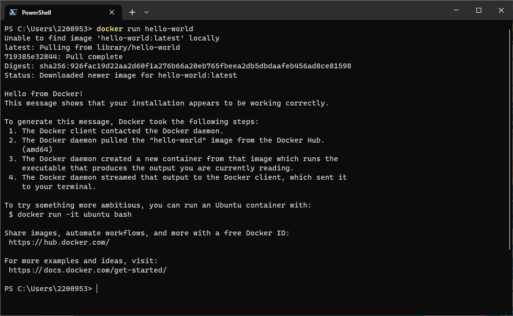
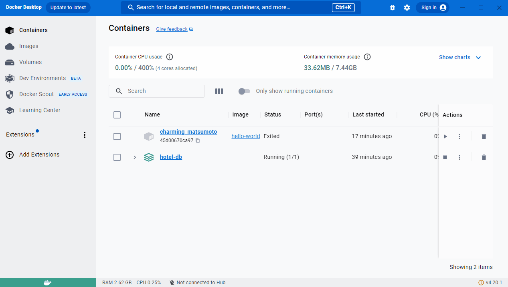
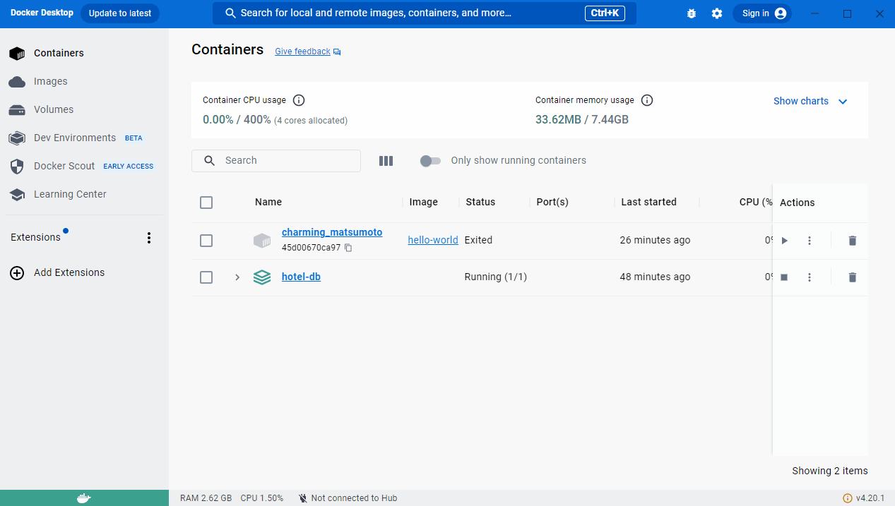
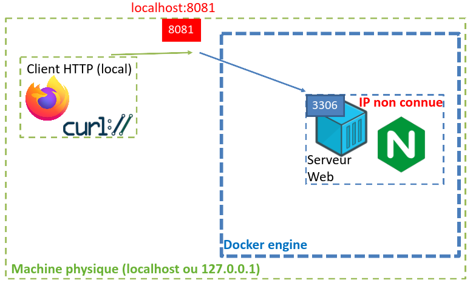

# Phase 1 : montée en compétences des équipes sur Docker

## Hello World!

> [!IMPORTANT]
> Une fois Docker démarré, ouvrez un Powershell et essayez la commande suivante :
> `docker run hello-world`

Si tout se passe bien vous devriez obtenir un résultat similaire à la capture suivante :



Attardons nous quelques instants sur le détails des étapes effectuées par Docker :
1. Le client Docker (utilisé en console Powershell) est entré en contact avec le "Docker daemon" (aussi appelé **"moteur Docker"**)
2. N'ayant pas l'image "hello-world" disponible, le moteur Docker a téléchargé l'image depuis la [banque d'images "Docker Hub"](https://hub.docker.com/).
3. Le moteur Docker a créé un nouveau conteneur à partir de l'image. Une fois démarré le conteneur a produit le texte.
4. Le moteur Docker a transmis le flux de données (le texte produit) au client Docker (la console Powershell).

### Analyse du conteneur "hello-world"
Il est possible d'analyser le contenu d'un container grâce à l'onglet "Containers" de Docker Desktop.
Le gif suivant présente la façon d'accéder aux "logs" d'un conteneur (vous remarquerez qu'il s'agit de ce qui est redirigé vers la console Powershell).




Les dossiers et fichiers contenus dans un conteneur peuvent également être visibles via le client Docker :



Dans le cas du conteneur basé sur une image "hello-world" le fichier contient une partie de code non compréhensible mais également le fameux texte affiché en console.

> [!TIP]
> Il est possible d'afficher les conteneurs en cours d'exécution grâce à la ligne de commande : `docker container ls`

### Manipulation d'images

Il vous est possible de manipuler les images disponibles sur une installation de Docker de deux façons :
- en ligne de commande ;
- via l'onglet "Images" du client graphique "Docker Desktop".

Vous trouverez ici les commandes les plus utilisées.

#### Liste des images

> [!TIP]
Commande : `docker images`

#### Suppression d'une image

```admonish info
Commande : `docker image rm <nom_image>`
```

> [!IMPORTANT]
Essayez de supprimer l'image intitulée "hello-world". Que se passe t-il ?

Pour arriver à vos fins, il vous faudra donc utiliser une autre commande :
```
docker container rm <id_conteneur>
```

> [!IMPORTANT]
> Supprimez le conteneur puis supprimez l'image "hello-world".

Pour en apprendre plus sur les commandes epxloitables avec Docker CLI : [cheatsheet](https://docs.docker.com/get-started/docker_cheatsheet.pdf).

## Créer une première image

Jusqu'à présent nous avons vu comment simplement utiliser une image disponible sur le Docker Hub (cas du "hello-world").

Nous avons vu que l'image "hello-world" contenait le code nécessaire pour afficher un message de bienvenue puis s'arrêtait. Comportement plutôt limité.

Rappelons l'objectif : embarquer dans une image l'ensemble des fichiers nécessaires au fonctionnement d'une application (base de données, site internet, application desktop, tout est possible).

Il va donc nous falloir un mécanisme permettant de configurer une image : le **Dockerfile**. 

## L'image "whalesay"

Dans la suite de cette partie nous utiliserons l'image [hibiki31/whalesay](https://hub.docker.com/r/hibiki31/whalesay/tags) qui est une variante de [docker/whalesay](https://hub.docker.com/r/docker/whalesay).

Cette image embarque une version de [Ubuntu](https://fr.wikipedia.org/wiki/Ubuntu_(syst%C3%A8me_d%27exploitation)) sur laquelle est installé le programme [cowsay](https://fr.wikipedia.org/wiki/Cowsay) qui fait parler une vache ASCII (pas de questions, s'il vous plaît).

Dans le cas de l'image [hibiki31/whalesay](https://hub.docker.com/r/docker/whalesay/) la vache a été remplacée par une baleine porte-conteneurs.

> [!IMPORTANT]
> Tapez la commande `docker run hibiki31/whalesay`.
> 
> Que se passe-t-il ?

Pour faire parler la baleine, vous pouvez ajouter une chaîne de caractère qui sera utilisée lors de l'instanciation du conteneur, par exemple de la façon suivante :

```bash
docker run hibiki31/whalesay cowsay "Booya!"
```

Cette commande démarre un nouveau container 

Vous pouvez lister les containers (qu'ils soient en cours d'exécution ou éteints) en utilisant la commande suivante : 
```bash
docker container list -al
```

Il n'est pas très pratique de devoir tout le temps souffler à la baleine ce qu'il faut dire.

Dans la suite de cette partie nous allons créer un fichier de configuration "Dockerfile" pour automatiser la commande "cowsay".

## Création d'un Dockerfile

Un `Dockerfile` est un fichier de configuration d'image.
Dans la grande majorité des cas un `Dockerfile` peut être vu comme un fichier de **customisation** d'une image existante (elle même basée sur un autre `Dockerfile`), il est très rare de créer une image "from scratch" et nécessaire uniquement pour des besoins spécifiques d'optimisation.

Notre objectif est de customiser l'image "whalesay" afin d'en créer une nouvelle.

> [!IMPORTANT]
> Créez dans un nouveau dossier nommé **"whalesay"** un fichier nommé **"Dockerfile"** (attention, la casse a son importance. De plus, il n'y a pas d'extension).

Ajoutez au fichier les instructions suivantes :
```bash
FROM hibiki31/whalesay

CMD cowsay "Hey ! Je sais quoi dire !"
```

Détails sur les instructions utilisées :
- `FROM` : indique l'image de base à utiliser pour la nouvelle image que nous souhaitons créer
- `CMD` : exécute une commande **au lancement du conteneur issu de cette image**

Pour information : les conteneurs sont basés sur des systèmes Linux (docker est un outil qui a initialement été conçu sur et pour Linux).
Pour cette raison les commandes qui peuvent être invoquées par l'instructif `CMD` sont des commandes de **terminal linux** (dans notre exemple : bash).

Il est maintenant possible de créer une nouvelle image basée sur "docker/whalesay" en utilisant la commande suivante :
```bash
docker build -t thatsmywhale .
```

L'option `-t` (pour "tag") permet de définir le nom de l'image qui sera créée.

Si tout se passe bien, une nouvelle image nommée "thatsmywhale" devrait être créée.

> [!IMPORTANT]
> Quelle serait la commande à utiliser pour démarrer un conteneur à partir de cette image ? Testez la.

La baleine commence a être de plus en plus intéressante, faisons maintenant en sorte de lui faire dire des messages aléatoires. Nous utiliserons l'outil [**"fortune"** qui affiche des citations](https://doc.ubuntu-fr.org/fortune). 

Changez le contenu du fichier "Dockerfile" de la façon suivante :

```bash
FROM hibiki31/whalesay

RUN apt-get -y update
RUN apt-get install -y fortunes

CMD fortune | cowsay
```

Une nouvelle instruction `Dockerfile` est utilisée ici :
- `RUN` : exécute une commande **à la création de l'image** 

> [!IMPORTANT]
> Contruisez à nouveau l'image et démarrez un conteneur (attention à bien supprimer l'ancienne image avant d'en recréer une).
> 
> À quoi pourrait servir, selon-vous, la commande Linux `/usr/games/fortune | cowsay ?

Vous venez d'apprendre à constuire une image sur-mesure à partir d'un fichier "Dockerfile".

Vous verrez, par la suite, comment faire en sorte de créer des images pour embarquer n'importe quel service (serveur Web, serveur de BD, reverse proxy...). Sachez que ceci n'est pas tant différent que de faire parler des baleines).

## Service web

Dans la suite de cette procédure vous apprendrez à concevoir une image de serveur web basé sur l'image `nginx` officielle documentée [ici](https://hub.docker.com/_/nginx).

Vous allez mener à bien les étapes suivantes pour mettre en place un tel service :
1. Création d'un fichier de configuration `Dockerfile`
2. Création d'un fichier de configuration pour le serveur `nginx` conteneurisé
3. Création d'une page HTML simple
4. Lancement et test du conteneur

Au final vous aurez une arboresence de fichiers de configuration similaire à :
```text

├── Dockerfile
├── html
│   └── index.html
└── nginx.conf
```

### Dockerfile

Voici un fichier `Dockerfile` à compléter (bien suivre les `TODOs`):

```dockerfile
# TODO compléter la version de l'image à utiliser
# Documentation : https://hub.docker.com/_/nginx
# Question à se poser : quelle est la différence entre "trixie" et "alpine" ?
FROM nginx:??????

# Suppression de la configuration par défaut (notre nginx.conf ne l'inclut pas)
RUN rm -f /etc/nginx/conf.d/default.conf

# Copie de la page dans le conteneur
COPY html/ /usr/share/nginx/html/

# Copie de la configuration dans le conteneur
# TODO ajuster la configuration
COPY <fichier-sur-l'hôte> /etc/nginx/nginx.conf

# Exposition du port 80
EXPOSE 80
```

### Fichier "html"

Voici un code simpliste pouvant être utilisé i(veillez à répondre aux `TODOs` et mettre ce fichier dans un sous-dossier par souci d'organisation):

```html
<!DOCTYPE html>
<html lang="fr">
<head>
  <meta charset="utf-8">
  <title>Service Web</title>
</head>
<body>
  <!-- TODO modifier la page -->
  <h1>À compléter</h1>
  <p>Serveur web conteneurisé.</p>
  <p>Pour voir quel conteneur répond, consultez <a href="/whoami">/whoami</a>.</p>
</body>
</html>

```

### Configuration `nginx`

Vous pourrez utiliser le fichier de configuration suivant (attention de bien compléter les TODO) :

```conf
# Les processus "worker" qui traitent les requêtes tournent sous cet utilisateur
user  nginx;
worker_processes auto;

# logs : l'image les redirige vers la sortie Docker (docker logs)
error_log /var/log/nginx/error.log warn;
pid       /var/run/nginx.pid;

events {
    worker_connections 1024;
}

# Configuration du HTTP, déclaration d'un contexte HTTP
# Permet de choisir comment le serveur va répondre aux requêtes HTTP
# Plus d'information ici : https://nginx101.com/directives/http/
http {
    include      /etc/nginx/mime.types;
    default_type application/octet-stream;

    # Sécurité : ne pas divulguer la version de Nginx aux clients
    server_tokens off;

    # Format de journal personnalisé (exploitable plus tard par des services tels que : Wazuh, Loki...) 
    log_format entreprise 'time=$time_iso8601 '
                          'client=$remote_addr '
                          'xff="$http_x_forwarded_for" '
                          'method=$request_method '
                          'uri="$request_uri" '
                          'status=$status '
                          'bytes=$body_bytes_sent '
                          'rt=$request_time '
                          'ua="$http_user_agent"';

    access_log /var/log/nginx/access.log entreprise;

    # Limites contre les abus
    client_max_body_size  1m;
    client_body_timeout   10s;
    client_header_timeout 10s;
    keepalive_timeout     15s;

    # Déclaration d'un serveur répondant à 80
    server {
        # Écoute sur le port 80 (attention, non sécurisé)
        lishttps://nginx101.com/directives/http/ten 80;
        server_name _;

        root  /usr/share/nginx/html;

        # Déclaration de la page d'index
        index index.html;

        # En-têtes de sécurité ("always" : aussi sur les pages d'erreur)
        add_header X-Frame-Options         "DENY"        always;
        add_header X-Content-Type-Options  "nosniff"     always;
        add_header Referrer-Policy         "no-referrer" always;
        add_header Content-Security-Policy "default-src 'self'" always;

        # Méthodes HTTP autorisées : GET et HEAD (uniquement la lecture, le POST ne passe pas, par exemple)
        if ($request_method !~ ^(GET|HEAD)$) {
            return 405;
        }

        location / {
            try_files $uri $uri/ =404;
        }

        # Chemin permettant de vérifier l'état du serveur (HEALTHCHECK)
        location = /health {
            access_log off;
            default_type text/plain;
            return 200 "OK\n";
        }

        # Quel conteneur répond ? Un appel de cet URL vous le dira.
        location = /whoami {
            default_type text/plain;
            return 200 "Conteneur : $hostname\n";
        }

        # Pas d'accès aux fichiers cachés (.git, .env...)
        # (juste si jamais il y a un oubli)
        location ~ /\. {
            deny all;
        }
    }
}
```

### Test de la configuration

> [!IMPORTANT]
> Une fois les fichiers créés, lancez un nouveau conteneur en effectuant :
> 1. construction de la nouvelle image
> 2. instanciation de l'image

Pour construire une nouvelle image :
```sh
docker build -t <nom-tag> .
```

Pour lancer l'image vous pouvez adapter la commande suivante :

```sh
docker run -d --name <nom-conteneur> -p 8081:80 <nom-image>
```

Parmis les paramètres de cette commande nous retrouvons :
- `-d` : pour "mode détaché", permet de récupérer la main sur le terminal
- `--name` : fourni un nom au conteneur instancié
- `-p` : effectue une redirection de port entre "localhost" (en écoute sur le port 8081) et le conteneur (`nginx` en écoute sur 80)

Une fois le conteneur démarré, observez la liste des conteneurs disponibles avec la commande :

```sh
docker ps -a
```

La commande devrait fournir un résultat similaire à :
```sh
CONTAINER ID  IMAGE                        COMMAND               CREATED         STATUS         PORTS                 NAMES
0476f2076b35  localhost/web-server:latest  nginx -g daemon o...  45 minutes ago  Up 45 minutes  0.0.0.0:8081->80/tcp  web-test
```

Il est important de notre la **redirection de port**, ceci est lié au fait que nous ne connaissons pas l'IP du conteneur ciblé.

Le schéma de principe ci-dessous illustre la redirection :



> [!IMPORTANT]
> Accéder aux pages fournies pas le serveur web nouvellement mis en place avec un client HTTP.
>
> Il est possible d'utiliser un navigateur web ou un outils de requêtage tel que `curl`.
>
> Commande `curl` utilisable :
> curl http://localhost:8081/health

> [!TIP]
> Pour le moment nous utilisons des conteneurs uniques, par la suite vous établirez des **compositions** de plusieurs conteneurs.
> Les conteneurs pourront, au besoin, communiquer entre eux en faisant référence à leur **nom de conteneur**.
>
> Un DNS interne à Docker est mise en place par défaut, le nom du conteneur deviendra sont "hostname".


