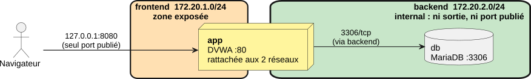
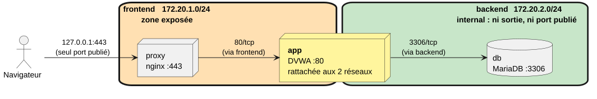

# Segmentation réseau

Une des règles fondamentale de la sécurité est : la base de données ne doit jamais être joignable depuis l'extérieur.

Comme dans une infrastructure traditionnellei (VLAN, pare-feu) il va falloir segmenter le réseau afin de limiter la surface d'attaque si le réseau exposé est conpromis.

> [!TIP]
> Jusqu'à présent aucun réseau n'a été configuré dans les fichiers de configuration Docker.
> 
> Dans cette configuration Docker crée un réseau "bridge" avec la machine hôte et tous les conteneurs se retrouvent sur le même réseau.

Réseaux à mettre en place :
- frontend : zone exposée, qui contient le proxy et l'application.
- backend : zone protégée, qui contient l'application et la base. Ce réseau est déclaré **`internal`** : aucune sortie vers l'extérieur, aucun accès possible.

L'application web est le seul pont entre les deux zones : elle est rattachée aux deux réseaux.

Voici un schéma récapitulatif de cet approche :



> [!WARNING]
> Un réseau Docker n'est pas un VLAN : tous les conteneurs partagent le même noyau et le même hôte.
>
> La publication d'un port (avec redirection) contourne les règles de pare-feu de l'hôte.


## Création de réseaux

La création de réseaux peut s'effectuer dans le fichier de composition `compose.yml` en ajoutant les lignes suivantes :
```yml
# Déclaration de la liste de services
services:
  # Conteneur de base de données
  db:
    # Reste de la configuration du conteneur "db"
    # ...
    # ...

    # Déclaration du réseau -> ajout automatique d'une interface
    networks:
      - backend
      
  # Conteneur de l'application web DVWA
  web-app:
    # Reste de la configuration du conteneur "web-app"
    # ..
    # ...

    # Déclaration des réseau rattachés -> ajout automatique de 2 interfaces
    networks:
      - frontend
      - backend

# Déclaration des réseaux
networks:
  frontend:
    driver: bridge
  backend:
    driver: bridge
    # Blocage des accès à l'extérieur, les conteneurs peuvent toujorus communiqué entre eux
    internal: true

```

Dans ce fichier de configuration le type `bridge` a été sélectionné, d'autres modes sont disponibles :
- `host` : accès direct au réseau hôte, suppression de l'isolation réseau entre l'hôte et le conteneur
- `none` : conteneur complétement isolé (même des autres), aucun accès réseau
- `overlay` : réseau 'multi-hôtes', permet la communication entre conteneurs sur plusieurs serveurs (par exemple avec Kubernetes)

Par défaut le mode est "bridge", vous trouverez plus d'informations sur le fonctionnement des réseaux Docker [ici](https://blog.stephane-robert.info/docs/conteneurs/moteurs-conteneurs/docker/network/).

> [!IMPORTANT]
> Modifiez votre configuration "compose.yml" pour mettre en place les sous-réseaux "frontend" et "backend" (pensez à bien supprimer votre ancienne composition grâce à `docker compose down`).
>
> Une fois la nouvelle composition démarrée, listez les adresses IP des conteneurs (sous Linux grâce à la commande `ip a`). Y-a-t-il le bon nombre d'interfaces ?
> Pour le conteneur "web-app" il vous faudra probablement installer le paquet `iproute2` (`apt install iproute2`) pour pouvoir utiliser "ip".

## Travailler avec un plan d'adressage

Lorsqu'un réseau Docker est créé automatiquement les adresses réseau sont choisie dans des plages pré-définies qui peuvent différer :
- 172.17.0.0/16 pour le réseau bridge (puis 172.18.0.0./16, 172.19.0.0/16... jusqu'à 172.31.0.0/16)
- des plages en 192.168.0.0/16
- 10.89.x.x/24..

Quand un conteneur démarre, Docker lui assigne la première adresse libre du sous-réseau choisi.

Dans le cas où un machine du réseau utilise la même adresse il peut y avoir chevauchement de sous-réseau.

Dans cette situation, plusieurs solutions :
1. changer la configuration du moteur Docker de façon à re-définir les adresse réseau utilisables
2. forcer dans la composition l'utilisation d'adresse spécifiques

Pour la second approche, voici le plan d'adressage proposé :
- frontend (172.20.1.0/24)
- backend (172.20.2.0/24)

Pour fixer des adresses réseau il est possible d'utiliser la balise IPAM (pour "IP Address Management"), par exemple :
```yml
networks:
  frontend:
    driver: bridge
    ipam:
      config:
        - subnet: 172.20.1.0/24
  backend:
    driver: bridge
    # Blocage des accès à l'extérieur, les conteneurs peuvent toujorus communiqué entre eux
    internal: true
    ipam:
      config:
        - subnet: 172.20.2.0/24
```

Plus d'informations sur la configuration IPAM disponible [ici](https://docs.docker.com/reference/compose-file/networks/#ipam).


> [!IMPORTANT]
> Modifiez votre configuration "compose.yml" pour mettre en place les sous-réseaux "frontend" et "backend" (pensez à bien supprimer votre ancienne composition grâce à `docker compose down`).
>
> Une fois la nouvelle composition démarrée, listez les adresses IP des conteneurs (sous Linux grâce à la commande `ip a`).

## Recommandation de l'ANSSI

Dans sa fiche technique portant sur les recommandations de sécurité (disponible [ici](https://messervices.cyber.gouv.fr/guides/recommandations-de-securite-relatives-au-deploiement-de-conteneurs-docker)) l'ANSSI préconise les sécurisation suivantes :

```text
R3 : Interdire la connexion du conteneur au réseau bridge docker0
Le service Docker doit être configuré pour démarrer un conteneur sans le connecter, par défaut, au réseau bridge, docker0, avec l’option --bridge=none (en ligne de commande ou dans le fichier de configuration).
```

```text
R4 : Isoler l'interface réseau de l'hôte
Chaque conteneur doit être démarré sans partager l’interface réseau de l’hôte. L’option `--network host` ne doit pas être utilisée.
```

```text
R5 : Créer un réseau dédié pour chaque connexion
Si le conteneur doit « exposer » un port de l’interface réseau de l’hôte ou doit être connecté à un ou plusieurs autres conteneurs, un réseau dédié doit être créé pour
chaque connexion.
```

En ajoutant des réseaux explicitement dans la configuration votre composition suit ces préconisations.

## Ajout d'un reverse-proxy

Pour le moment le service web tourne en HTTP (non sécurisé), le serveur `Nginx` récupère les requêtes non chiffrée.

Il nous serait possible d'activer le HTTPS directement sur le conteneur de l'application web mais il est souhaitable d'intégrer un "reverse proxy".

Le "reverse proxy" est un serveur intermédiaire placé devant les serveurs applicatifs : son rôle est de **recevoir les requêtes des clients et les transférer au bon serveur**.
C'est la porte d'entrée de l'applicatif.

Plusieurs avantages à ce fonctionnement :
- ces ce serveur qui se chargera du chiffrement des données (HTTPS)
- les serveurs applicatifs sont cachés
- les logs d'accès sont centralisés sur ce serveur
- pas de multiplication des configurations concernant l'accès, centralisation sur le reverse proxy

L'objectif est donc de mettre en place le fonctionnement indiqué par le schéma suivant :



### Fichiers de configuration

Vous allez pouvoir ajouter un conteneur "reverse proxy" à votre composition, plusieurs logiciels peuvent permettre de mettre en place un tel serveur :
- nginx
- caddy
- traeffik
...

La suite vous indiquera comme mettre en place ["nginx"](https://hub.docker.com/_/nginx).

L'image "nginx" officielle du "Docker Hub" peut être utilisée, il va cependant falloir lui ajouter un fichier de configuration spécifique à notre cas, voici une ébauche (TODO à compléter) :
```nginx
# Reverse proxy
user  nginx;
worker_processes auto;
error_log /var/log/nginx/error.log warn;
pid       /var/run/nginx.pid;

events { worker_connections 1024; }

http {
    include      /etc/nginx/mime.types;
    default_type application/octet-stream;
    server_tokens off;

    log_format entreprise 'time=$time_iso8601 client=$remote_addr '
                          'method=$request_method uri="$request_uri" '
                          'status=$status bytes=$body_bytes_sent '
                          'rt=$request_time ua="$http_user_agent"';
    access_log /var/log/nginx/access.log entreprise;

    # Déclaration d'un serveur écoutant sur le port 80
    server {
        # Port en écoute par le conteneur
        # ATTENTION : à terme le reverse proxy devra éouter sur 443 (HTTPS)
        # À tester dans un premier temps sur 80
        listen 80;
        server_name _;

        add_header X-Content-Type-Options "nosniff" always;
        add_header Referrer-Policy        "no-referrer" always;

        # Pour toute requête sur "/", on redirige
        location / {
            # La redirection se fait avec "proxy_pass"
            # Habituellement nous y mettons une URL
            # Ici, l'URL n'est pas connue mais nous pouvons utiliser un NOM DE CONTENEUR
            # Les conteneurs se connaissent entre eux via le nom (DNS interne à Docker)
            # TODO paramétrer la rediction comme il le faut
            proxy_pass         http://???????????????????:80;
            proxy_set_header   Host              $host;
            proxy_set_header   X-Real-IP         $remote_addr;
            proxy_set_header   X-Forwarded-For   $proxy_add_x_forwarded_for;
            proxy_set_header   X-Forwarded-Proto $scheme;
            proxy_read_timeout 30s;
        }
    }
}
```

Ce fichier de configuration sera à transférer dans le conteneur, voici un extrait de fichier `compose.yml` permettant d'instancier un conteneur "reverse proxy" avec la configuration qui convient :
```yml
services:
  reverse-proxy:
    # TODO choisir version de l'image adaptée
    image: docker.io/library/nginx:???????
    # TODO ajouter nom de conteneur
    container_name: ??????
    restart: unless-stopped
    # Montage d'un volume pour passer le fichier de configuration dans le conteneur
    volumes:
      - ./reverse-proxy/nginx.conf:/etc/nginx/nginx.conf:ro
    depends_on:
      - web-app
    # TODO configurer la redirection de port qui convient
    ports:
      ????
    # TODO ajouter les réseaux qui conviennet
    networks:
      ?????
```

Les lignes suivantes importantes :
```yml
    volumes:
      - ./reverse-proxy/nginx.conf:/etc/nginx/nginx.conf:ro
```

Un volume permet de faire un lien entre un fichier (ou un dossier) de la machine hôte avec un fichier (ou un dossier) du conteneur.

Dans notre cas ce mécanisme est utilisé pour monter le fichier `nginx.conf` (du sous-dossier `./reverse-proxy` de la machine hôte) dans le conteneur dans le dossier `/etc/nginx/`.

En fin de ligne l'indicateur ":ro" signifie "read only", ainsi le conteneur ne peux pas changer le contenu du fichier `nginx.conf`.

> [!IMPORTANT]
> Une fois les fichiers de configuration ajoutés/modifiés, testez votre composition en essayant d'accéder à l'application en passant par le "reverse proxy".


### Activation du HTTPS

Voici un fichier de configuration "nginx" utilisable pour ajouter un certificat autosigné au "reverse proxy" :

```nginx
# Reverse proxy
user  nginx;
worker_processes auto;
error_log /var/log/nginx/error.log warn;
pid       /var/run/nginx.pid;

events { worker_connections 1024; }

http {
    include      /etc/nginx/mime.types;
    default_type application/octet-stream;
    server_tokens off;

    log_format entreprise 'time=$time_iso8601 client=$remote_addr '
                          'method=$request_method uri="$request_uri" '
                          'status=$status bytes=$body_bytes_sent '
                          'rt=$request_time ua="$http_user_agent"';
    access_log /var/log/nginx/access.log entreprise;

    # Configuration TLS
    ssl_protocols             TLSv1.2 TLSv1.3;   # pas de SSLv3, TLS 1.0 ni 1.1
    ssl_prefer_server_ciphers off;               # laisse le client choisir parmi des suites sûres
    ssl_session_cache         shared:SSL:10m;
    ssl_session_timeout       1d;
    ssl_session_tickets       off;


    # Serveur en écoute sur 80, uniquement utilisé pourla redirection
    server {
        listen 80;
        server_name _;
        # On retourne un message de redirection au client (301)
        return 301 https://$host:8443$request_uri;
    }

    server {
        listen 443 ssl;
        http2 on;
        server_name _;

        # Référence vers les les certificats SSL utilisé
        # ATTENTION : non exploitable en production
        # Faire appel à une authorité de certification
        # Commande pour créer le certificat (avec openssl) :
        # openssl req -x509 -nodes -days 365 -newkey rsa:2048 -keyout server.key -out server.crt
        # Attention à bien mettre l'IP du serveur (127.0.0.1 si vous voulez tester en local) pour le FQDN lors de la création du certificat
        ssl_certificate /etc/nginx/certs/server.crt;
        ssl_certificate_key /etc/nginx/certs/server.key;
        
        add_header X-Content-Type-Options "nosniff" always;
        add_header Referrer-Policy        "no-referrer" always;
        location / {
            # Redirection vers le serveur de l'application web
            # Ici nous utilisons le nom du conteneur
            proxy_pass         http://web-app:80;
            proxy_set_header   Host              $host;
            proxy_set_header   X-Real-IP         $remote_addr;
            proxy_set_header   X-Forwarded-For   $proxy_add_x_forwarded_for;
            proxy_set_header   X-Forwarded-Proto $scheme;
            proxy_read_timeout 30s;
        }
    }
}
```

L'extrait suivant mérite explication :
```nginx
server {
    listen 80;
    server_name _;
    # On retourne un message de redirection au client (301)
    return 301 https://$host:8443$request_uri;
}
```

Ces lignes permettent d'ajouter une écoute sur le port 80, quand parvient une requête sur ce port "nginx" retourne un [code 301](https://fr.wikipedia.org/wiki/HTTP_301) **au client**.

301 est un code de redirection, le navigateur client adresse alors sa requête au port **8443** (et non pas 443).

> [!CAUTION]
> Dans le fichier de composition il faudra bien faire attention de faire la redirection depuis le port 8443 vers le port 443.

> [!IMPORTANT]
> Effectuez les modifications suivantes pour mettre en place le HTTPS :
> - créer le certificat (cf. commande dans l'extrait de configuration) ;
> - ajouter des volumes pour monter les informations de certificat
> - ajouter les redirections de ports qui conviennent
>
> Testez votre configuration en essayant d'accéder au service à partir d'un navigateur.
